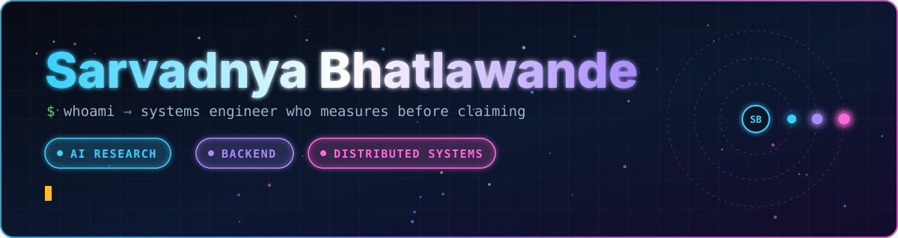
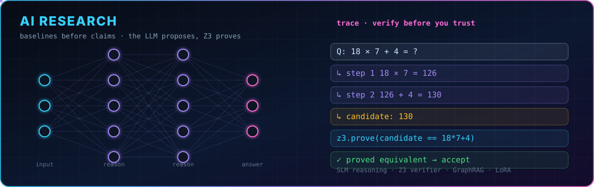
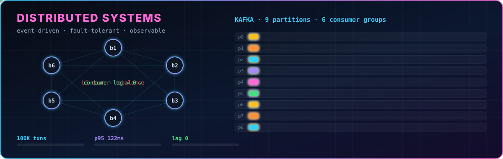
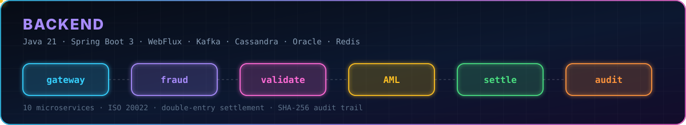

<div align="center">




[](https://huggingface.co/Ram20307)
[](https://linkedin.com/in/sarvadnya-bhatlawande)

</div>

## ⚡ By the numbers

<div align="center">


</div>

## 👋 About

B.Tech Computer Engineering at **VIT Pune** (2023–27, top 1% of the department). I like the layer where systems meet intelligence: a kernel's page-fault handler, a Kafka consumer group at 100K txns, an LLM agent that has to be provably right. Currently a **Software Engineering Intern at Barclays**, building an ECDD / AML compliance platform (Java, Spring Boot, React, Oracle, OpenShift).

## 🏆 Trophy wall

| Year | Result | Event |
|---|---|---|
| 2026 | 🥇 **1st Prize** | Impetus PICT InC (International): Sanjaya |
| 2026 | 🥇 **1st Place** | iMocha AI Hackathon (won in-house while interning there) |
| 2025 | 🏛️ **Top 12** | **Aavishkar Research Convention** (Govt. of Maharashtra): state-level, represented SPPU |
| 2025 | 🥇 **1st Place** | TECHTHESIS Bharatiyugam (National Research Innovation) |
| 2025 | 🥈 **2nd Place** | IETE NLPC (National, 61 teams) |
| 2025 | 🥉 **3rd Place** | ASPIRE 2K25 (National, 50+ teams) |
| 2024 | 🥇 **1st Place** | Pulzion'24 Applied Research Expo, PICT ACM |
| 2024 | 🥉 **3rd Place** | Navdhara 2024 |

📄 **IEEE SILCON 2024**: LoRA/QLoRA fine-tuning for domain-specific NLP · **IJRES 2025**: classical-ML ADAS (XGBoost, SIFT, ORB) on Raspberry Pi edge hardware · 🤗 [1,200+ downloads](https://huggingface.co/Ram20307) on medical-domain summarization models.

## 🧭 What I work on





## 🚀 Featured work

| Project | What it is | Stack |
|---|---|---|
| [**ClearFlow**](https://github.com/sarvadnya2030/Clearflow) | ISO 20022 payment platform: 10 microservices, WebFlux gateway → LightGBM fraud scoring → AML screening → Cassandra double-entry settlement → SHA-256 audit. Load-tested at **100K txns, p95 = 122 ms, consumer lag 0**. Includes an RCA agent over **4.4M ELK events** that rebuilds cascade failure chains via correlationId. | `Java 21` `Spring Boot 3` `Kafka` `K8s` `Cassandra` `NVIDIA NIM` |
| **Sanjaya** | Video analytics for surveillance: saliency gating (~50% fewer frames), tracking, int8 VLM (~70% less VRAM), Neo4j knowledge graph (10 node / 15+ relation types) and a **Hybrid RAG** (GraphRAG + FAISS + JSON). 🥇 Impetus PICT InC 2026. | `Python` `FastAPI` `Neo4j` `FAISS` `OpenCV` |
| [**MOS**](https://github.com/sarvadnya2030/MOS) | Multiprogramming OS simulator: page tables, demand paging, page-fault handling, interrupt-driven kernel, PCB scheduling with load/ready/IO/terminate queues. | `C++` |
| [**AI Compiler Optimizer**](https://github.com/sarvadnya2030/AI-Compiler-Optimizer) | An LLM proposes code optimizations; a **Z3 verifier proves equivalence** or returns a counterexample. The LLM is never trusted for correctness. | `Python` `Z3` |
| [**SLM Reasoning Research**](https://github.com/sarvadnya2030/Rsearch_Experiments_SLM) | Pre-registered experiments on which reasoning supervision actually helps small models (Qwen3-0.6B, GSM8K). Baselines before claims. | `PyTorch` `Transformers` |
| [**HC01 ICU Decision Support**](https://github.com/sarvadnya2030/ignisia-mitwpu-hackathon) | 8-agent parallel clinical pipeline with z-score outlier holds, RAG guidelines and Nemotron-120B synthesis. | `FastAPI` `NVIDIA NIM` `MIMIC-III` |
| **TE AI Cup** | Led Team VishwaSena (5) in TE Connectivity's international AI Cup: SAP analytics, XGBoost demand forecasting and CLIP + DINOv2 part search over **48,000+ parts** and **128,000+ yearly SAP transactions**, identification in under 2 s, projecting **€150K savings** over 5 years. | `CLIP` `DINOv2` `XGBoost` `SHAP` `React` |

<details open>
<summary><b>🔬 ClearFlow: how a payment moves</b></summary>

```mermaid
flowchart LR
    A[WebFlux<br/>gateway] --> B[LightGBM<br/>fraud score]
    B --> C[IBAN / BIC /<br/>embargo checks]
    C --> D[Camunda BPMN<br/>AML screening]
    D --> E[(Cassandra<br/>double-entry<br/>settlement)]
    E --> F[SHA-256<br/>audit trail]
    A -. 9 partitions · 6 consumer groups .- D
    F -. 4.4M log events .-> G{{RCA agent<br/>Nemotron-120B}}
```

p50 49 ms · p95 122 ms · p99 167 ms · 95% acceptance with correct AML rejections · Kafka consumer lag 0 after drain.

</details>

## 💼 Experience

- **Barclays**, SWE Intern, Pune (Jun–Aug 2026): ECDD compliance platform for PEP screening, adverse media and AML case management in a regulated environment.
- **iMocha**, AI/ML Engineer Intern (Dec 2025–May 2026): skills-NER pipeline at **0.8 s/resume** (Redis + thread pool), fine-tuned LLMs to **83.8%** grounding accuracy, shipped real-time face-recognition proctoring to production.

## 🛠 Toolbox

<div align="center">


</div>

**Also:** Hugging Face · FAISS · OpenCV · LoRA/QLoRA · Camunda · OpenTelemetry · WebFlux · NVIDIA NIM · Ollama · Z3

## 📊 Stats

<div align="center">


</div>

<div align="center">

📍 Pune, India · ✉️ [sarvadnya.bhatlawande2005@gmail.com](mailto:sarvadnya.bhatlawande2005@gmail.com)


</div>
